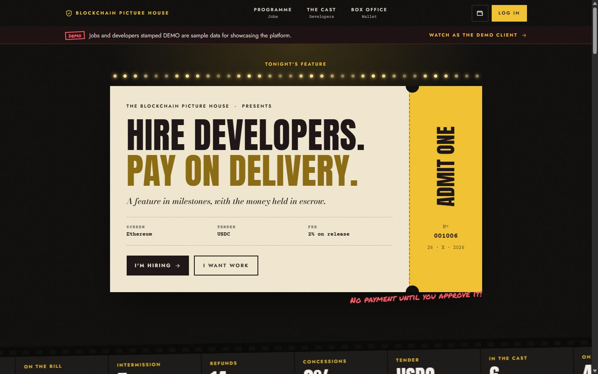
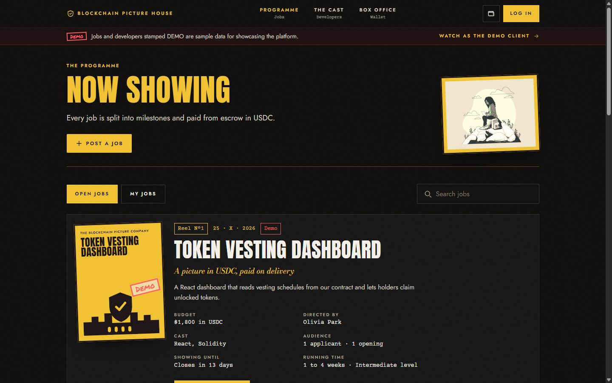
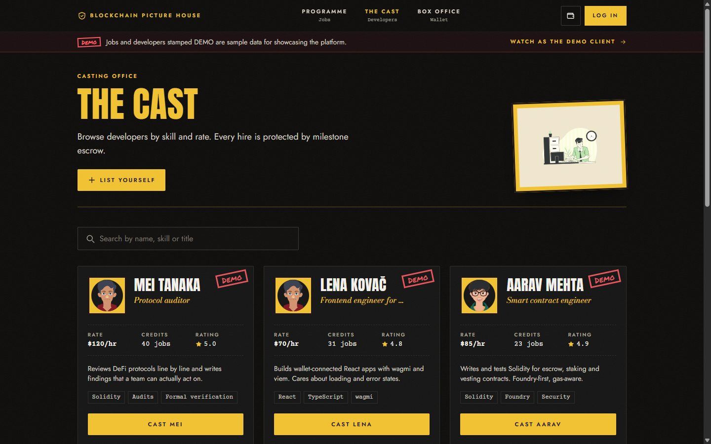
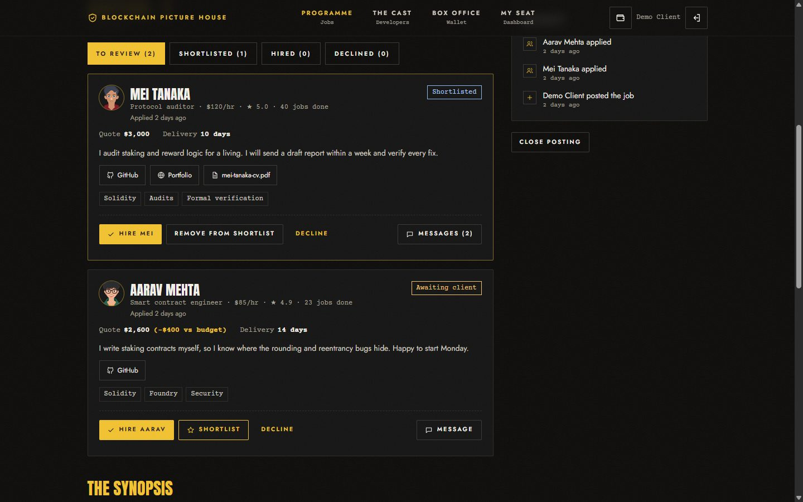
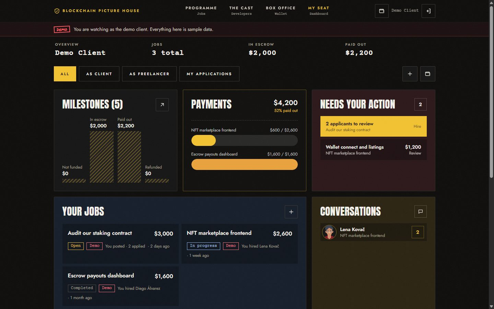
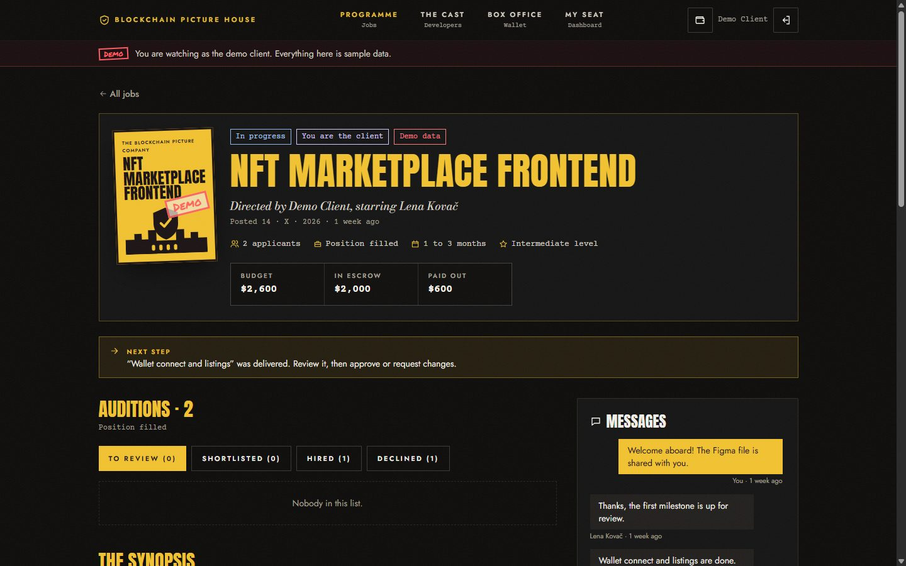
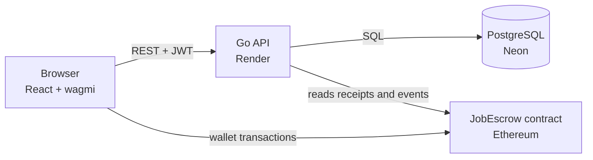
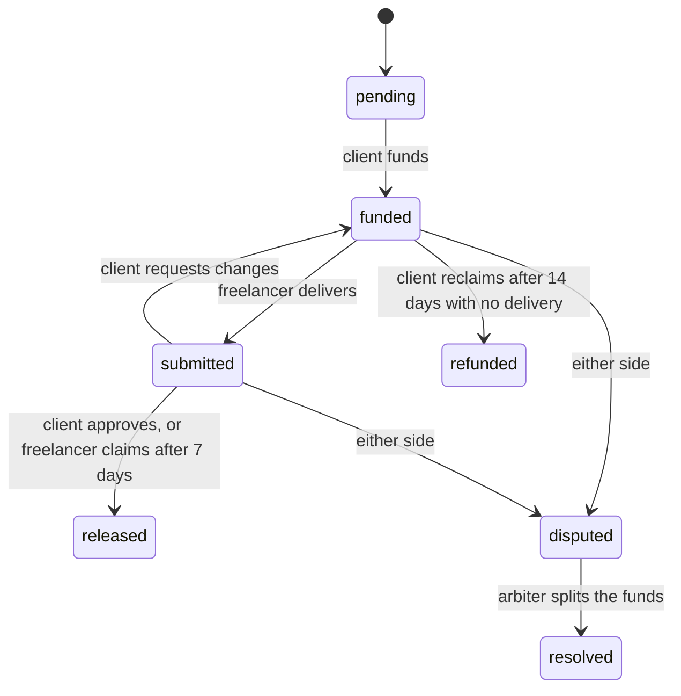

# Blockchain Freelance

Hire developers and pay in USDC. Each job is split into milestones; the client funds a milestone into escrow,
the freelancer delivers, and the client approves it to release payment.

**Live demo: https://decentralized-frellancing-platform.vercel.app**

- API: https://freelance-api-7v0a.onrender.com (free tier: the first request after a quiet spell takes up to a minute)
- Demo login: `demo@blockchainfreelance.dev` / `demo1234`, or click **Watch as the demo client** on the site.
  Jobs and developers stamped **DEMO** are sample data.
- The live site runs in preview mode: milestones are tracked by the API and no real USDC moves.
  See [Sepolia testnet](#sepolia-testnet) to connect the escrow contract.



| | |
|---|---|
|  |  |
| **Jobs:** budget, openings, applicants, closing date, duration and level | **Developers:** rate, completed jobs and rating from client reviews |
|  |  |
| **Applicants:** quote vs budget, delivery estimate, GitHub, portfolio, resume, shortlist and pre-hire chat | **Dashboard:** money by milestone state, payments, what needs your action, conversations |



## What it does

- **Post a job:** milestones with USDC amounts, number of openings, how long applications stay open, expected duration and experience level.
  With several openings, each hire gets their own contract with its own copy of the milestones.
- **Apply:** a cover note, a price quote, a delivery estimate, and at least one of a PDF resume, a GitHub link or a portfolio link.
  Applicants can withdraw while the client is still deciding.
- **Hire:** the client shortlists, declines and messages applicants before hiring, then confirms the hire.
- **Work:** the client funds each milestone, the freelancer delivers a link with a note, and the client approves it or requests changes.
  Either side can open a dispute with a reason; the arbiter rules on a split.
- **Get paid:** approval releases the milestone (2% fee from the freelancer's share). A silent client lets the freelancer claim after 7 days;
  no delivery lets the client reclaim after 14.
- **Afterwards:** the client reviews the freelancer and the profile rating becomes the average of their reviews.
- Every job has an activity log and a "next step" hint. Deliverables are visible only to the two parties and the arbiter.
  Resumes open only for the applicant and the client they applied to.

## Stack

- `src/` React 19 + Vite + Tailwind 4 frontend, wagmi/viem for the Ethereum wallet
- `server/` Go API (stdlib `net/http`, PostgreSQL via pgx): auth (email, Google, Sign-In with Ethereum), developers, jobs,
  applications, milestones, chat, reviews. Uploaded files are stored in Postgres.
- `contracts/` Solidity escrow (`JobEscrow.sol`) with Hardhat tests
- `docker-compose.yml` a dedicated Postgres 17 on port 5434 (so it never clashes with other local databases)
- `backend/` the previous Express/Mongo API, kept for reference

Deployed with the frontend on Vercel, the API on Render (`server/Dockerfile`) and the database on Neon.
Set `SEED_DEMO=true` on the API to add the labelled demo data and the public demo login.

## How it fits together



- **Preview mode** (no contract configured, as on the live site): the API runs the milestone state machine itself
  and records every step.
- **On-chain mode** (`ESCROW_ADDRESS` and `RPC_URL` set): the wallet sends the transaction first, then gives its hash
  to the API. The API reads the receipt, checks the event matches that exact milestone, and only then updates the
  database. The contract enforces who may act and when; the API never trusts the browser about money.

Milestone states:



## Run it locally

Needs Node 20+, Go 1.22+ and Docker Desktop (running).

```sh
npm install
npm run dev          # Postgres (:5434) + Go API (:3001) + Vite (:5173), preview mode
```

Open http://localhost:5173 and leave the terminal open (Ctrl+C stops everything). `npm run dev` checks for Docker
and Go and says what is missing. If port 5173 is taken by another project, close it first.

To start with sample data and the demo login, set `SEED_DEMO=true` in `server/.env` (copy it from
`server/.env.example`).

Other scripts: `npm run db` (database only), `npm run api` (API only), `npm run web` (frontend only),
`npm run lint`, `npm run build`.

### With a local blockchain

```sh
npm run contracts:install   # once
npm run dev:chain           # adds a Hardhat node (:8545), deploys MockUSDC + JobEscrow and wires the API to it
```

In MetaMask, add the network (RPC `http://127.0.0.1:8545`, chain ID `31337`) and import one of the Hardhat test
accounts printed in the terminal. On the Wallet page, **Get 10,000 test USDC** mints mock USDC.

### Sepolia testnet

```sh
cd contracts && cp .env.example .env     # SEPOLIA_RPC_URL, DEPLOYER_PRIVATE_KEY (a throwaway test key only)
npm run deploy:sepolia                   # uses Circle's Sepolia USDC; prints ESCROW_ADDRESS, CHAIN_ID, RPC_URL
```

Put the three printed values into the API's environment and restart it.

## Configuration (`server/.env`)

| Variable | What it does |
|---|---|
| `DATABASE_URL` | Postgres connection string. Defaults to the Docker database on port 5434. |
| `JWT_SECRET` | Signs login tokens. Set a long random value; without it, logins reset on every restart. |
| `FRONTEND_URL` | The site allowed to call the API (CORS) and where Google login returns to. |
| `PORT` | API port, default `3001`. |
| `ADMIN_EMAILS` | Comma-separated emails of the platform arbiter, who resolves disputes. |
| `GOOGLE_CLIENT_ID`, `GOOGLE_CLIENT_SECRET`, `GOOGLE_CALLBACK_URL` | Optional Google login. |
| `FEE_BPS`, `CLAIM_AFTER_DAYS`, `REFUND_AFTER_DAYS` | Escrow rules: fee in basis points (200 = 2%) and the two time windows. Keep them equal to the contract's. |
| `ESCROW_ADDRESS`, `CHAIN_ID`, `RPC_URL` | Turn on on-chain mode. Leave empty for preview mode. |
| `SEED_DEMO` | `true` adds the labelled demo data and the public demo login. |

The frontend reads one variable at build time: `VITE_API_URL`, the API's address (defaults to `http://localhost:3001`).

## Deploy your own

1. **Database:** create a free Postgres on [Neon](https://neon.tech) and copy its connection string.
   Tables are created automatically when the API starts.
2. **API on Render:** new Web Service from this repo, runtime Docker, Dockerfile `server/Dockerfile`, build context
   `server`, health check `/api/health`. Set `DATABASE_URL`, `JWT_SECRET`, `FRONTEND_URL` and optionally `SEED_DEMO=true`.
3. **Frontend on Vercel:** import the repo (framework Vite), set `VITE_API_URL` to the Render URL.
   `vercel.json` sends every route to the app so page refreshes work.

Pushing to `main` redeploys both.

## API overview

| Method and path | Purpose |
|---|---|
| `POST /api/auth/signup`, `POST /api/auth/login`, `GET /api/auth/me` | Email accounts |
| `GET /api/auth/wallet/nonce`, `POST /api/auth/wallet/verify` | Sign-In with Ethereum |
| `GET /api/developers`, `POST/PUT/DELETE /api/developers/{id}` | Developer profiles |
| `GET /api/jobs`, `GET /api/jobs/mine`, `POST /api/jobs`, `GET /api/jobs/{id}` | Jobs |
| `POST /api/jobs/{id}/apply` | Apply (JSON, or multipart with a PDF resume) |
| `POST /api/applications/{id}/status`, `DELETE /api/applications/{id}` | Shortlist or decline; withdraw |
| `GET/POST /api/applications/{id}/messages` | Pre-hire messages between client and applicant |
| `POST /api/jobs/{id}/hire`, `POST /api/jobs/{id}/cancel` | Hire an applicant; close a posting or end an unfunded contract |
| `POST /api/milestones/{id}/{action}` | `fund`, `submit`, `revise`, `approve`, `claim`, `refund`, `dispute`, `resolve` |
| `GET/POST /api/jobs/{id}/messages` | Chat between the client and the hired freelancer |
| `POST /api/jobs/{id}/review` | Client rates the freelancer after completion |
| `GET /api/admin/disputes` | The arbiter's queue |
| `GET /api/files/{id}` | Profile photos (public) and resumes (applicant and client only) |
| `POST /api/jobs/{id}/escrow` | Attach the on-chain escrow a client opened |

## Tests

```sh
npm run contracts:test        # contract tests, including a randomised conservation check
cd server && go test ./...    # API tests: the whole hiring and payment flow, chain verification, demo seed (needs `npm run db`)
node scripts/e2e.mjs          # real chain + real contract + real API + Postgres, the whole money path
```

## Contract rules (`contracts/contracts/JobEscrow.sol`)

- A client opens an escrow with a list of milestones and funds each one (USDC) before work starts.
- The freelancer submits a hash of the deliverable link; the client approves to release.
- Payouts are credited and pulled with `withdraw()`. The 2% fee comes out of the freelancer's share only.
- Client silent for 7 days after a submission: the freelancer can `claim`. No submission for 14 days: the client can `refund`.
- Either side can `dispute`; the arbiter can only split that milestone between the two parties.
- `pause()` stops new money coming in. It never blocks withdrawals or exits.
- The contract has no change-request step, so in on-chain mode changes are asked for in the chat or through a dispute.

## Limits

- The contract is not audited. Get a professional review before putting real funds through it.
- The live demo runs in preview mode; no real USDC moves until a contract is connected.
- Render's free tier sleeps when idle, so the first request after a quiet spell is slow.
- There are no email notifications yet: people see updates when they open the site.
